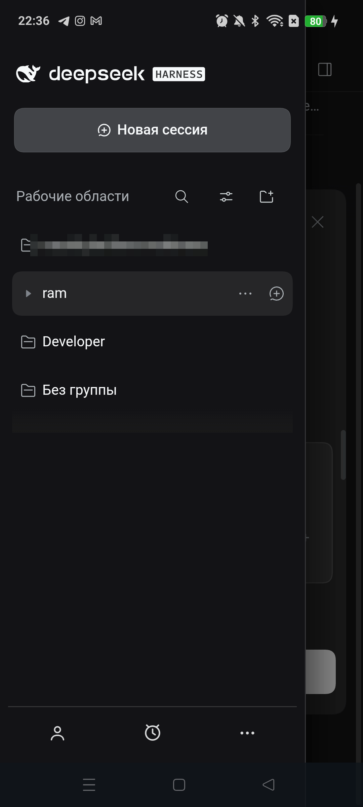
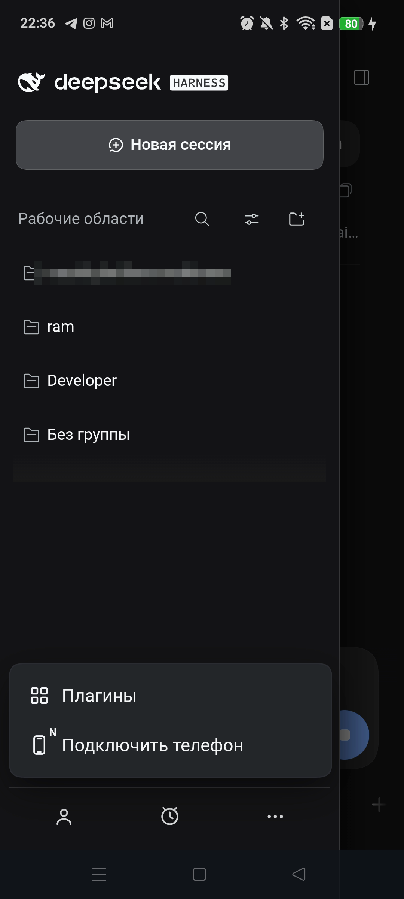
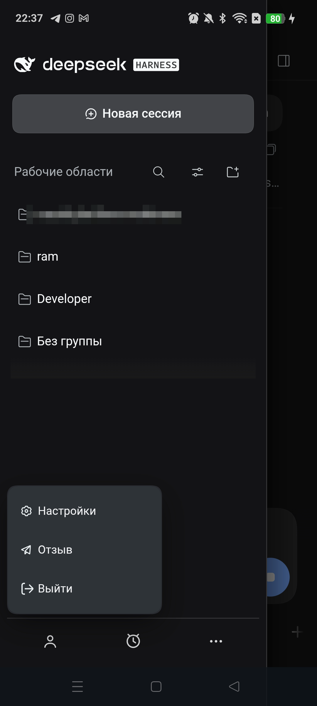
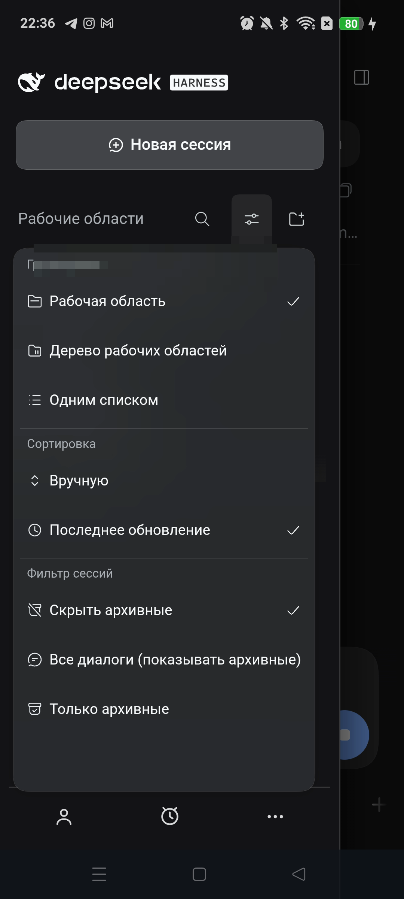
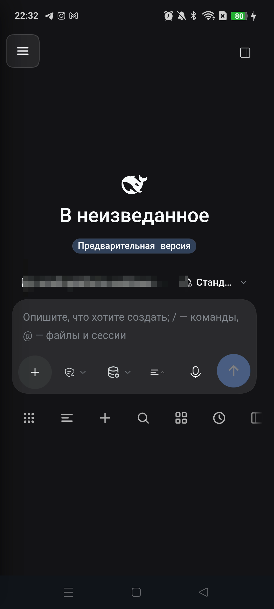
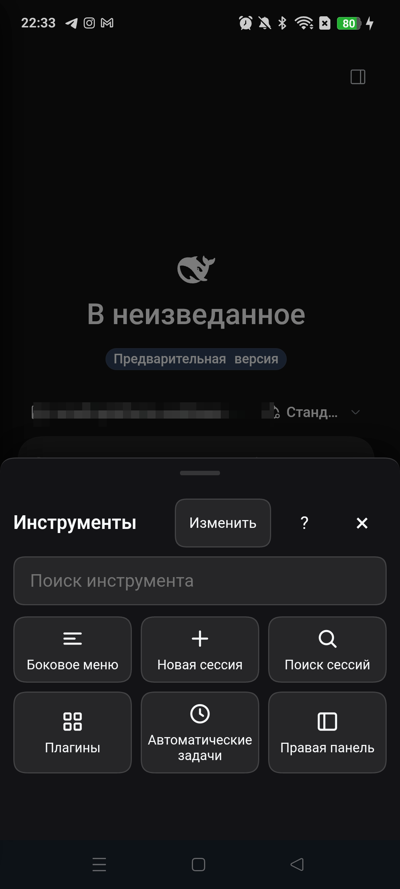
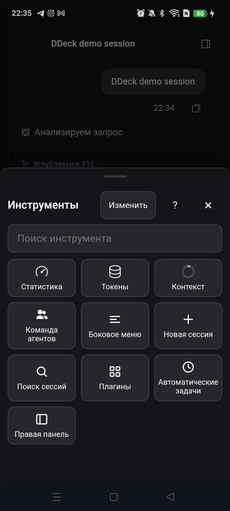

# DDeck

<p align="center"></p>

[](https://github.com/nemezida1337/ddeck-client/actions/workflows/android.yml)
[](https://github.com/nemezida1337/ddeck-client/releases)
[](LICENSE)

[**Website**](https://nemezida1337.github.io/ddeck-client/) ·
[Features](#features) ·
[Quick start](#quick-start) ·
[Connect](#connection) ·
[Requirements](#requirements) ·
[FAQ](#faq)

**DDeck** is a full remote deck for **your own computer** running
**DeepSeek Harness**: chat, tools, queue, files and terminal from an Android
phone, over a self-hosted TLS gateway. There is no DDeck cloud: the phone reaches
your computer over LAN, Tailscale or your own VPS relay.

[**Download APK 0.9.10-beta**](https://github.com/nemezida1337/ddeck-client/releases/download/v0.9.10-beta/DDeck-0.9.10-beta.apk)
· [SHA-256](https://github.com/nemezida1337/ddeck-client/releases/download/v0.9.10-beta/DDeck-0.9.10-beta.apk.sha256)
· [All releases](https://github.com/nemezida1337/ddeck-client/releases)
· [Install the plug-in](plugin/README.md)
· [How to connect](docs/CONNECT.md)
· [Own server](docs/RELAY.md)

**Current version:** 0.9.10-beta (versionCode 910). This is a beta; further versions follow after stabilization and a separate decision.

## What's new in 0.9.10

- **Mobile settings** are now full-screen: all five tabs visible, close in the header, session dock hidden underneath.
- **Account and balance** are compact cards without clipping or empty columns.
- **Appearance** is a “Light · Dark · System” segment with finger-sized controls.
- **Models, built-in plugins and presets** use tidy cards and non-overlapping sub-tabs.
- **Right-edge clipping fixed** on phones; the desktop-only DDeck row with a 404 is hidden.
- Version 0.9.10-beta (910).


> Unofficial client. Not affiliated with or endorsed by DeepSeek.

## Features

| Feature | What it does |
|---|---|
| Mobile DSH | chat, streaming, tools, plugins, automations, subagents, plan review and message queue |
| **Custom bottom bar** | thumb-friendly tools: swipe, “All tools” grid, collapse chevron, reorder and hide tiles |
| **Custom sidebar** | workspaces and sessions, search, long-press actions, account and settings with large touch targets |
| **Multiple computers** | the phone keeps several paired computers; “More → Switch computer” adds one without dropping the current session |
| **Phone-to-phone pairing** | the first phone shows a QR and one-time code for a second phone; the computer and second phone need not be nearby |
| Right panel | files, terminal, browser and journal in one place |
| Notifications | turn completion and agent questions while the app is in the background |
| Attachments | system file picker, queue and session export downloads |
| Voice input | microphone in the composer |
| RU / EN / 中文 | both DSH and the mobile layer |

## Screens

| Sidebar | “More”: plugins and second phone |
|---|---|
|  |  |

| Account and settings | Workspace grouping |
|---|---|
|  |  |

| New session and bottom bar | All tools |
|---|---|
|  |  |

| Test session: tool panel |
|---|
|  |

Personal workspace and session names are redacted in the screenshots; the UI is
the real DDeck interface on a phone.

**Bottom bar.** Tools under your thumb: swipe, “All tools” grid, chevron and
tile customization.

**Sidebar.** Workspaces, sessions, search, account and settings in one drawer.
First tap selects a row, second tap opens it.

**Phone-to-phone.** On the first phone: sidebar → “More” → “Connect a phone” →
computer password → QR. The second phone scans it and gets an independent session.

## Quick start

Full guide: [GETTING-STARTED.md](docs/GETTING-STARTED.md).

1. **Install DeepSeek Harness** — [official page](https://www.deepseek.com/harness/).
   A plugin-capable version is required.
2. **Install the plug-in on the computer:**
   ```sh
   dsh plugin --profile desktop add ddeck-remote
   ```
   For a web/CLI profile use `web` instead of `desktop`. Without a terminal, add
   the [market index](https://nemezida1337.github.io/ddeck-client/index.json)
   under “Plugins → Discover → Index sources”.
3. **Fully restart DSH** — the **DDeck** panel appears at startup.
4. **Install the APK** from the [release](https://github.com/nemezida1337/ddeck-client/releases/tag/v0.9.10-beta)
   on Android 10+ and open DDeck.
5. In **DDeck** tap **“New code”**, then **“Scan QR from computer”** on the phone.

The QR/code lives for **five minutes** and works once. Repository installation
for npm-less setups is described below.

### Plug-in installation

**From npm (recommended):**

```sh
dsh plugin --profile desktop add ddeck-remote
```

Web/CLI profile: `dsh plugin --profile web add ddeck-remote`.

**From the repository:** the plug-in is linked into the DSH profile;
`pnpm`/`npm install` is not needed — the QR library and TLS transport are already
bundled in `plugin/lib`.

**macOS / Linux**

```sh
# macOS: once, if Command Line Tools are missing
xcode-select --install
# Debian/Ubuntu: sudo apt install python3

git clone https://github.com/nemezida1337/ddeck-client.git ddeck
cd ddeck
./plugin/install.sh
```

**Windows (PowerShell 5.1+)**

```powershell
git clone https://github.com/nemezida1337/ddeck-client.git ddeck
cd ddeck
powershell -ExecutionPolicy Bypass -File .\plugin\install.ps1
# or double-click plugin\install.cmd
```

Non-default DSH profile:

```sh
./plugin/install.sh /path/to/profile
# Windows:
powershell -File .\plugin\install.ps1 -Profile C:\Users\me\.dsh\profiles\desktop
```

Default profile: `~/.dsh/profiles/desktop`.

**Update:** `git pull`, run the installer again, restart DSH.
**Remove:** `./plugin/uninstall.sh` (Windows: `plugin\uninstall.ps1`). Pairing
data in `~/.dsh/dsh-remote` is preserved.

## Connection

### Tailscale (recommended)

Enable Tailscale on the computer and phone in the same tailnet, open the DDeck
panel and scan the QR. The phone reaches the computer over the tailnet, including
mobile data.

### Own VPS relay

Run **DDeck Relay** on your VPS; the plug-in keeps a reverse SSH tunnel and the
phone connects to the public address. See [`docs/RELAY.md`](docs/RELAY.md).
On Windows the automatic `setup.sh` needs WSL or a Linux host; the plug-in itself
and LAN/Tailscale work natively.

### Manual

On the connection screen tap **“Enter address and code manually”** and type the
computer address and six-digit code from the panel.

## Phone-to-phone pairing

1. The first phone is already paired with the computer.
2. On the first phone: sidebar → “More” → **“Connect a phone”**.
3. Enter the password set on the computer in the DDeck panel.
4. The first phone shows a QR and a one-time code — scan it with the second phone,
   or enter the address and code manually.
5. Both devices appear in the DDeck panel on the computer; revoke the extra one if
   needed.

The two phones get **independent sessions**. The first phone can be closed; the
second keeps working.

## Bottom bar

The bottom bar is more than a row of icons:

- scrolls left/right;
- the dots button opens **all tools**;
- the chevron collapses it and frees space for the chat;
- long-press a tile to reorder tools;
- “Customize bottom bar” hides extra tiles; they stay in the grid.

## Sidebar

Open it with the top-left button or an edge swipe:

- scrollable workspaces and sessions;
- session search and view options;
- first tap selects a row and shows actions, second tap opens it;
- swiping a row never opens a random chat;
- footer: account, history and “More” (plugins, connect a second phone);
- “Back” closes the drawer instead of leaving the app.

## Requirements

| Part | Requirement |
|---|---|
| Phone | Android 10+ (`minSdk 29`), arm64 |
| Computer, macOS | tested: macOS + DeepSeek Harness (`desktop` profile) |
| Computer, Linux | beta: `plugin/install.sh`, Python 3; LAN/Tailscale |
| Computer, Windows | beta: `plugin/install.ps1`, PowerShell 5.1+; LAN/Tailscale |
| DSH | plug-in support (`^0.1.5-rc.1 \|\| ^0.2.1-rc.2`); tested on 0.2.1-rc.5 |
| Remote access | Tailscale **or** your own VPS relay |
| Installer | Python 3 (macOS/Linux) or PowerShell (Windows); Node.js is not required |

Platform details, profiles and limits: [`docs/PLATFORMS.md`](docs/PLATFORMS.md).

## Compatibility

- macOS is the primary tested path.
- Linux and Windows installers are included; the gateway is cross-platform Node,
  so LAN/Tailscale should work. Automatic VPS relay on Windows needs WSL/Linux;
  full Linux/Windows runs are not claimed as verified yet.
- After a major DSH update, check the DDeck panel; the mobile layer may need a
  plug-in update.

## Security and data

- Computer data lives in `~/.dsh/dsh-remote`; phone secrets are in Android
  Keystore-backed encrypted storage.
- The computer's TLS certificate is pinned during pairing (CA = `instanceId`).
- The pairing code is one-time and lives for five minutes.
- There is no DDeck server; Tailscale is peer-to-peer, a self-hosted relay goes
  through your VPS.
- Never share a QR/code: it grants remote control of the computer.

## FAQ

**Is this an official DeepSeek client?**  
No. DDeck is an unofficial Android client for your own DeepSeek Harness.

**Does it need internet?**  
Not on a local network. From outside, use Tailscale or your own VPS relay.

**Can I keep several computers?**  
Yes: “More → Switch computer”. The current session is not dropped.

**Is there an iOS version?**  
Planned, no date yet. Android 10+ only for now.

## Roadmap after beta

- **DDeck Cloud / relay** — connect without Tailscale or your own VPS; workspace in the mobile app.
- **Group access** — password, roles and revocation for one computer, server or cloud workspace.
- **iOS, iPad, Android tablets** — native app and responsive UI.
- **Collaboration** — several people in one workspace, each with an independent session.

These are directions, not date promises. Details: [ROADMAP.md](docs/ROADMAP.md).

## Beta limitations

- Android only; iOS/iPadOS is planned.
- No Google Play/RuStore publication yet.
- Background notifications depend on Android foreground service; aggressive OEM
  builds may drop some.
- Tablet layout is not polished.
- Linux/Windows installation is beta; macOS remains the reference platform.

## Troubleshooting

| Symptom | What to do |
|---|---|
| No DDeck panel after install | fully restart DSH; check `~/.dsh/profiles/desktop/package.json` and `cordis.patch.yml` |
| QR does not find the computer | check Tailscale/network; get a fresh code |
| Fingerprint error | “Forget” the computer and pair again with a fresh QR |
| Mobile data fails | enable Tailscale; a public IPv4 relay may be unreachable on IPv6-only networks |
| No notifications | allow notifications and disable battery optimization for DDeck |
| No voice input | allow microphone access in Android settings |

## Links

- [Connect](docs/CONNECT.md)
- [Tailscale](docs/TAILSCALE.md)
- [Own server](docs/RELAY.md)
- [Privacy](docs/PRIVACY.md)
- [Security](docs/SECURITY.md)
- [Plug-in installation](plugin/README.md)
- [Issues](https://github.com/nemezida1337/ddeck-client/issues)
- [Releases](https://github.com/nemezida1337/ddeck-client/releases)

## License

Apache-2.0. The vendored gateway transport is Apache-2.0; attribution in
[`plugin/NOTICE`](plugin/NOTICE), [`plugin/THIRD-PARTY-LICENSES.md`](plugin/THIRD-PARTY-LICENSES.md)
and [`plugin/vendor/gateway/VENDORED.md`](plugin/vendor/gateway/VENDORED.md).
Android dependencies are listed in `android/THIRD-PARTY-NOTICES.md`.
