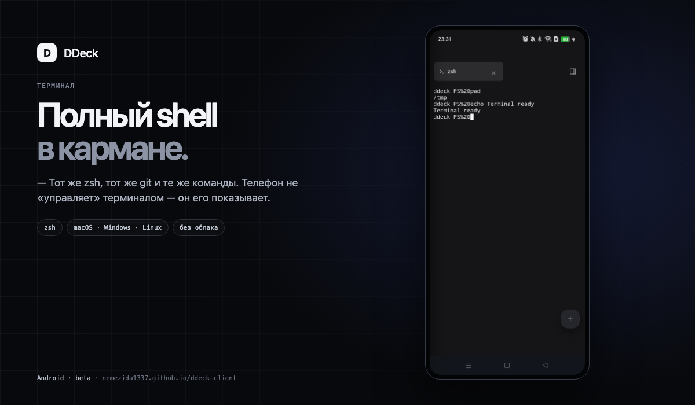
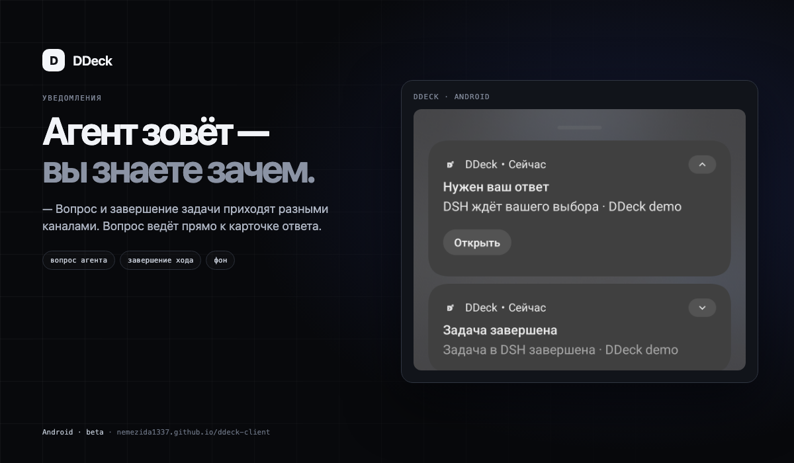
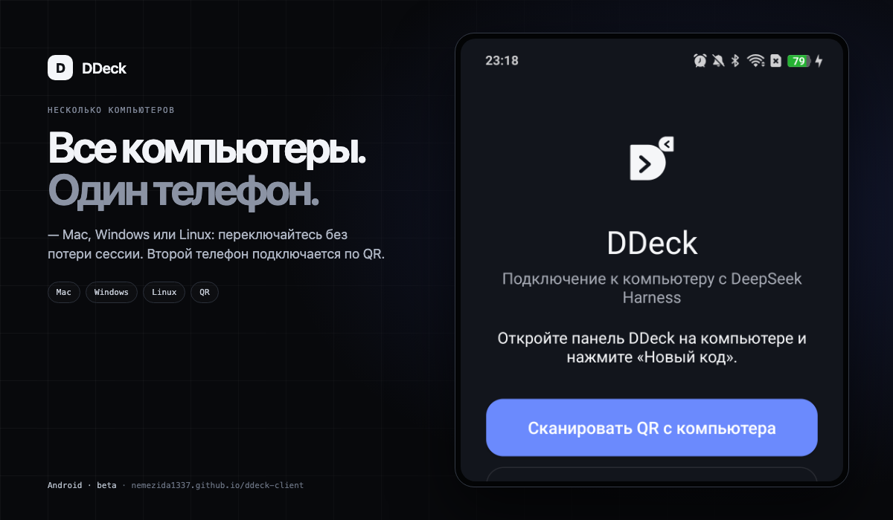
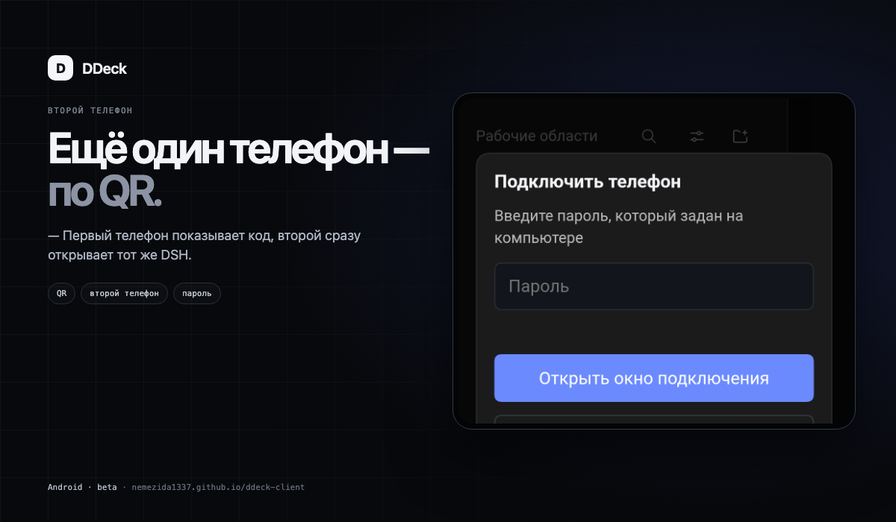

# DDeck

<p align="center"></p>

[](https://github.com/nemezida1337/ddeck-client/actions/workflows/android.yml)
[](https://github.com/nemezida1337/ddeck-client/releases)
[](LICENSE)

[**Сайт**](https://nemezida1337.github.io/ddeck-client/) ·
[Возможности](#что-умеет) ·
[Быстрый старт](#быстрый-старт) ·
[Подключение](#подключение) ·
[Требования](#требования) ·
[FAQ](#faq) ·
[Разработка](#разработка)

**DDeck** — полноценный пульт к вашему компьютеру с **DeepSeek Harness**.
Чат, инструменты, очередь, файлы и терминал — с Android-телефона, через
собственный TLS-шлюз. Без облака DDeck: компьютер и телефон соединяются
напрямую через локальную сеть, Tailscale или ваш VPS-релей.

[**Скачать APK 0.10.0-beta**](https://github.com/nemezida1337/ddeck-client/releases/download/v0.10.0-beta/DDeck-0.10.0-beta.apk)
· [SHA-256](https://github.com/nemezida1337/ddeck-client/releases/download/v0.10.0-beta/DDeck-0.10.0-beta.apk.sha256)
· [Все релизы](https://github.com/nemezida1337/ddeck-client/releases)
· [Установка плагина](plugin/README.md)
· [Как подключиться](docs/CONNECT.md)
· [Свой сервер](docs/RELAY.md)

**Текущая версия:** 0.10.0-beta (versionCode 1000). Проект в бете; следующие версии — после стабилизации и отдельного решения.

## Что нового в 0.10.0

- Кастомная нижняя панель сайдбара: «Аккаунт», «Задачи», «Ещё» — с подписями и safe-area.
- Мобильный слой почищен: мёртвые CSS-селекторы удалены, suffix-гейты зелёные.
- Единая проверка версии по всем релизным поверхностям.
- UX-аудит и независимые проверки меню, настроек и автоматизаций.
- Версия 0.10.0-beta (1000).


> Неофициальный клиент. Не связан с DeepSeek и не заменяет DeepSeek Harness.

## Что умеет

| Возможность | Что именно |
|---|---|
| Мобильный DSH | переписка, стриминг, инструменты, плагины, автоматические задачи, субагенты, plan review и очередь сообщений |
| **Своя нижняя панель** | быстрые инструменты под большим пальцем: свайп, сетка «Все инструменты», сворачивание шевроном, перестановка и скрытие плиток |
| **Своё боковое меню** | рабочие области и сессии, поиск, действия по долгому нажатию, аккаунт и настройки — с крупными целями и нормальным «назад» |
| **Несколько компьютеров** | телефон хранит несколько сопряжённых компьютеров; «Ещё → Сменить компьютер» добавляет новый, не разрывая текущую сессию |
| **Телефон через телефон** | первый телефон показывает QR и одноразовый код для второго — компьютер и второй телефон могут даже не быть рядом |
| Правая панель | файлы, терминал, браузер и журнал в одном месте |
| Уведомления | завершение хода и вопрос агента приходят, когда приложение свёрнуто |
| Вложения | системный файловый пикер, очередь, скачивание экспорта сессии |
| Голосовой ввод | встроенный микрофон в композере |
| RU / EN / 中文 | интерфейс DSH и мобильный слой |

## Как это выглядит

| Терминал | Уведомления |
|---|---|
| [](docs/screenshots/showcase/terminal.png) | [](docs/screenshots/showcase/notifications.png) |
| [](docs/screenshots/showcase/computers.png) | [](docs/screenshots/showcase/pairing.png) |


## Быстрый старт

Подробный гайд: [GETTING-STARTED.md](docs/GETTING-STARTED.md).

1. **Установите DeepSeek Harness** — [официальная страница](https://www.deepseek.com/harness/).
   Нужна версия с поддержкой плагинов.
2. **Поставьте плагин на компьютер:**
   ```sh
   dsh plugin --profile desktop add ddeck-remote
   ```
   Для web/CLI-профиля замените `desktop` на `web`. Без терминала добавьте
   [индекс маркета](https://nemezida1337.github.io/ddeck-client/index.json)
   в «Плагины → Обзор → Источники индексов».
3. **Полностью перезапустите DSH** — появится панель **DDeck**. Патч профиля
   читается только при старте.
4. **Установите APK** из [релиза](https://github.com/nemezida1337/ddeck-client/releases/tag/v0.10.0-beta)
   на Android 10+ и откройте DDeck.
5. В панели **DDeck** нажмите **«Новый код»**, на телефоне — **«Сканировать QR с компьютера»**.

QR/код живёт **5 минут** и используется один раз. Старый QR не подойдёт.
Дальше — отдельная установка из репозитория, если npm недоступен.

### Установка плагина

**Из npm (рекомендуется):**

```sh
dsh plugin --profile desktop add ddeck-remote
```

Для web/CLI-профиля: `dsh plugin --profile web add ddeck-remote`.

**Из репозитория** — если npm недоступен. Плагин ставится ссылкой на папку
репозитория; `pnpm`/`npm install` не нужен, QR-библиотека и TLS-транспорт уже
собраны в `plugin/lib`.

**macOS / Linux**

```sh
# macOS: один раз, если нет Command Line Tools
xcode-select --install
# Debian/Ubuntu: sudo apt install python3

git clone https://github.com/nemezida1337/ddeck-client.git ddeck
cd ddeck
./plugin/install.sh
```

**Windows (PowerShell 5.1+)**

```powershell
git clone https://github.com/nemezida1337/ddeck-client.git ddeck
cd ddeck
powershell -ExecutionPolicy Bypass -File .\plugin\install.ps1
# либо двойной клик по plugin\install.cmd
```

Если DSH установлен в нестандартный профиль:

```sh
./plugin/install.sh /путь/к/профилю
# Windows:
powershell -File .\plugin\install.ps1 -Profile C:\Users\me\.dsh\profiles\desktop
```

По умолчанию используется `~/.dsh/profiles/desktop`.

**Обновление:** `git pull` и снова `install.sh`/`install.ps1`, затем
перезапустите DSH.

**Удаление:** `./plugin/uninstall.sh` (Windows — `plugin\uninstall.ps1`).
Данные сопряжений в `~/.dsh/dsh-remote` не удаляются.

## Подключение

### Tailscale — рекомендуемый способ

Включите Tailscale на компьютере и телефоне в одном tailnet, откройте панель
DDeck и отсканируйте QR. Телефон ходит на tailnet-адрес компьютера напрямую;
работает и по сотовой сети.

### Свой VPS-релей

Если Tailscale не подходит, поднимите **DDeck Relay** на своём VPS: плагин
держит обратный SSH-туннель, телефон подключается к публичному адресу.
Инструкция: [`docs/RELAY.md`](docs/RELAY.md). На Windows автоматический
`setup.sh` требует WSL или Linux-хост; сам плагин и Tailscale/LAN работают
нативно.

### Вручную

На экране подключения нажмите **«Ввести адрес и код вручную»** и введите адрес
компьютера и шестизначный код из панели.

## Телефон через телефон

Второй телефон подключается без доступа к компьютеру:

0. На компьютере: панель DDeck → «Второй телефон» → задайте пароль (6–64 символа) → «Сохранить пароль».
1. Первый телефон уже сопряжён с компьютером.
2. На первом телефоне откройте боковое меню → «Ещё» → **«Подключить телефон»**.
3. Введите пароль, заданный на компьютере в панели DDeck.
4. На первом телефоне появится QR и одноразовый код — отсканируйте его вторым
   телефоном или введите адрес и код вручную.
5. На компьютере в панели DDeck появятся оба устройства; лишнее можно отозвать.

Оба телефона получают **независимые сессии**. Первый телефон можно закрыть —
второй продолжит работать.

## Нижняя панель

Нижняя панель — это не просто ряд иконок:

- листается влево-вправо;
- кнопка с точками открывает **все инструменты**;
- шеврон справа сворачивает панель, освобождая место чату;
- долгое нажатие на иконке позволяет переставить инструменты;
- «Настройка нижней панели» скрывает лишние плитки — они остаются в сетке.

## Боковое меню

Меню открывается кнопкой слева сверху или свайпом от края:

- рабочие области и сессии с прокруткой;
- поиск сессий и фильтры;
- первое касание строки выделяет её и показывает действия, второе — открывает;
- свайп по строке не открывает случайный чат;
- внизу — аккаунт, история и «Ещё»: плагины, подключение второго телефона;
- «назад» закрывает меню, а не выходит из приложения.

## Требования

| Компонент | Требование |
|---|---|
| Телефон | Android 10+ (`minSdk 29`), arm64 |
| Компьютер, macOS | проверено: macOS + DeepSeek Harness (профиль `desktop`) |
| Компьютер, Linux | бета: `plugin/install.sh`, Python 3; LAN/Tailscale |
| Компьютер, Windows | бета: `plugin/install.ps1`, PowerShell 5.1+; LAN/Tailscale |
| DSH | поддержка плагинов (`^0.1.5-rc.1 \|\| ^0.2.1-rc.2`); проверено на 0.2.1-rc.5 |
| Удалённый доступ | Tailscale **или** свой VPS-релей |
| Для установки | Python 3 (macOS/Linux) или PowerShell (Windows); Node.js не нужен |

Подробности по платформам, профилям и ограничениям — [`docs/PLATFORMS.md`](docs/PLATFORMS.md).

## Совместимость

- macOS — основной проверенный путь.
- Linux и Windows — установщики плагина добавлены; базовое подключение через
  LAN/Tailscale рассчитано на кроссплатформенный Node-шлюз. Автоматический
  VPS-релей на Windows требует WSL/Linux; полный прогон на этих ОС пока не
  заявлен как проверенный.
- После крупного обновления DSH проверьте панель DDeck: мобильный слой может
  потребовать обновления плагина.

## Безопасность и данные

- На компьютере данные лежат в `~/.dsh/dsh-remote`, на телефоне — в
  зашифрованном хранилище Android Keystore.
- TLS-сертификат компьютера закрепляется при сопряжении (CA = `instanceId`).
- Код сопряжения одноразовый и живёт 5 минут.
- Серверов DDeck нет; при Tailscale трафик идёт напрямую, при своём релее —
  через ваш VPS.
- Не передавайте QR/код посторонним: это доступ к управлению компьютером.

## FAQ

**Это официальный клиент DeepSeek?**  
Нет. DDeck — неофициальный Android-клиент к вашему DeepSeek Harness.

**Нужен ли интернет?**  
Для локальной сети — нет. Для доступа с улицы — Tailscale или свой VPS-релей.

**Можно ли подключить несколько компьютеров?**  
Да: «Ещё → Сменить компьютер». Список хранится на телефоне, текущая сессия не
разрывается.

**Куда уходят данные?**  
Только на ваш компьютер и через выбранный канал связи. У DDeck нет собственных
серверов; TLS-сертификат закрепляется при сопряжении.

**Будет ли iOS?**  
В планах, но сроков нет. Сейчас Android 10+.

## Планы после беты

- **DDeck Cloud / релей** — подключение без Tailscale и своего VPS; рабочая область в мобильном приложении.
- **Групповой доступ** — пароль, роли и отзыв доступа к одному компьютеру, серверу или облачной рабочей области.
- **iOS, iPad, Android-планшеты** — нативное приложение и адаптация интерфейса.
- **Коллективная работа** — несколько людей в одной рабочей области, у каждого своя сессия.

Это направления, а не обещания по датам. Подробнее: [ROADMAP.md](docs/ROADMAP.md).

## Ограничения беты

- Только Android; iOS/iPadOS — в планах.
- Публикация в Google Play/RuStore ещё не выполнялась.
- Уведомления в фоне зависят от foreground-сервиса Android; на агрессивных
  прошивках возможны пропуски.
- Планшетная раскладка не полировалась.
- Linux/Windows — бета-поддержка установки; macOS остаётся эталонной
  платформой.

## Диагностика

| Симптом | Что сделать |
|---|---|
| Нет панели DDeck после установки | полностью перезапустите DSH; проверьте `~/.dsh/profiles/desktop/package.json` и `cordis.patch.yml` |
| Не находит компьютер по QR | проверьте Tailscale/сеть; получите свежий код |
| Ошибка отпечатка | «Забыть» компьютер и сопрягите заново по свежему QR |
| Телефон не подключается по сотовой | включите Tailscale; публичный IPv4-релей может быть недоступен в IPv6-only сети |
| Нет уведомлений | разрешите уведомления приложению и отключите оптимизацию батареи для DDeck |
| Нет голосового ввода | разрешите микрофон в настройках Android |

## Разработка

```sh
npm test                    # 63 теста протокола и мобильного слоя
npm run verify:standalone   # проверка протокольных векторов
npm run skin:check          # синтаксис мобильного слоя
```

Android:

```sh
cd android
./gradlew assembleRelease
```

Публикация npm идёт через GitHub Actions (`release.yml`, trusted publishing по
тегу `v*`); APK/AAB собираются локально и прикладываются к GitHub Release.

## Ссылки

- [Стать тестером](https://nemezida1337.github.io/ddeck-client/#testers) — бета и помощь с установкой
- [Память проекта](docs/PROJECT-MEMORY.md) — текущий релиз, сборка, инварианты
- [Сайт](https://nemezida1337.github.io/ddeck-client/)
- [С чего начать](docs/GETTING-STARTED.md)
- [Подключение](docs/CONNECT.md)
- [Tailscale](docs/TAILSCALE.md)
- [Свой сервер](docs/RELAY.md)
- [Политика конфиденциальности](docs/PRIVACY.md)
- [Безопасность](docs/SECURITY.md)
- [Установка плагина](plugin/README.md)
- [Issues](https://github.com/nemezida1337/ddeck-client/issues)
- [Релизы](https://github.com/nemezida1337/ddeck-client/releases)

## Лицензия

Apache-2.0. Вендоренный транспорт шлюза — Apache-2.0; атрибуция в
[`plugin/NOTICE`](plugin/NOTICE), [`plugin/THIRD-PARTY-LICENSES.md`](plugin/THIRD-PARTY-LICENSES.md)
и [`plugin/vendor/gateway/VENDORED.md`](plugin/vendor/gateway/VENDORED.md).
Android-зависимости — в `android/THIRD-PARTY-NOTICES.md`.
